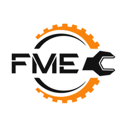

<p align="center">
  
</p>

<h1 align="center">FME-CAD</h1>

<p align="center"><b>Phần mềm CAD 2D của FME: vẽ kỹ thuật, kích thước, layer, đọc và ghi DWG/DXF.</b></p>

FME-CAD là bản tùy biến của [CADCraft](https://github.com/storytold/cadcraft), một phần mềm CAD 2D mã nguồn mở viết bằng Rust, dùng giấy phép MIT OR Apache-2.0. FME-CAD giữ nguyên toàn bộ tính năng của CADCraft, đổi tên và nhận diện sang FME, và **cập nhật thường xuyên theo bản gốc**.

FME-CAD không do nhóm ArtCraft làm ra, tài trợ hay xác nhận.

## Tính năng chính (kế thừa từ CADCraft)
- Thao tác kiểu AutoCAD:
  - dòng lệnh, bắt điểm, layer, đầy đủ lệnh DIM*, DIMSTYLE, MLEADER, hatch, block;
  - layout và in ra PDF.
- Đọc và ghi **DXF** (R12–2018) và **DWG** (R13–2018).
- Chạy trên Windows, macOS, Linux.
- **Điều khiển tự động** qua dòng lệnh, JSON và MCP (xem `docs/cli.md`, `docs/control-protocol.md`). Đây là nền để FME ghi kích thước tự động lên bản vẽ xuất từ CATIA.

## Build

Cần Rust 1.95 trở lên.

Chạy ứng dụng:

```bash
cargo run --release -p cadcraft
```

Build bản phát hành. File chạy nằm ở `target/release/cadcraft(.exe)`:

```bash
cargo build --release -p cadcraft
```

Có thể build sẵn trên GitHub: vào tab Actions, chọn workflow **FME build**, tải về `FME-CAD.exe`.

## Cập nhật theo CADCraft và nhận diện FME

Toàn bộ phần riêng của FME nằm trong thư mục [`fme/`](fme/). Xem [`fme/BAO_TRI.md`](fme/BAO_TRI.md).

| Việc | Lệnh |
|---|---|
| Cập nhật theo CADCraft mới nhất | `bash fme/sync.sh` (cũng chạy tự động hằng tuần trên GitHub) |
| Đổi tên, màu, kênh cập nhật | Sửa `fme/brand.toml` rồi `python3 fme/rebrand.py` |
| Thay logo | `python3 fme/make_icons.py --from-png logo.png` rồi `python3 fme/rebrand.py` |

## Giấy phép
- Mã nguồn: MIT OR Apache-2.0, giống CADCraft (`LICENSE-MIT`, `LICENSE-APACHE`). Thông báo bản quyền gốc được giữ trong `NOTICE` và `ATTRIBUTION.md`.
- Tên và logo FME thuộc FME.
